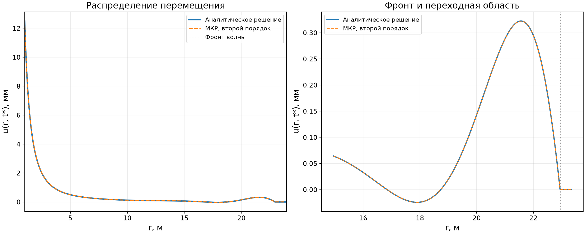

# Задача 1. Волна сжатия от сферической полости

**PDF-отчёт:** [Task1_Spherical_Wave.pdf](reports/Task1_Spherical_Wave.pdf). В отчёте приведены вывод уравнений, граничные условия, конечно-разностная схема, аналитическое решение, график и проверка сходимости. Ниже — тот же материал в формате Markdown с математической разметкой GitHub.

## 1. Данные и обозначения

Рассматривается внешняя область $r\ge R$. Перемещение $u(r,t)$ направлено радиально наружу; положительными считаются растягивающие напряжения, поэтому давление на внутренней стенке создаёт отрицательное нормальное напряжение.

| Величина | Обозначение | Значение |
|---|---:|---:|
| Модуль Юнга | $E$ | $5.4\cdot10^9\ \mathrm{Па}$ |
| Модуль сдвига | $\mu$ | $2.0\cdot10^9\ \mathrm{Па}$ |
| Плотность | $\rho$ | $1800\ \mathrm{кг/м^3}$ |
| Радиус полости | $R$ | $1\ \mathrm{м}$ |
| Амплитуда давления | $P_0$ | $10^8\ \mathrm{Па}$ |
| Пространственный шаг | $h$ | $0.01R=0.01\ \mathrm{м}$ |
| Шаг времени | $\tau$ | $h/C_p$ |
| Момент расчёта | $t_*$ | $0.01\ \mathrm{с}$ |

Здесь $p(t)=P_0H(t)$, $H(t)$ — функция Хевисайда. Параметры Ламе — $\lambda,\mu$; деформация — $\varepsilon_{ij}$; напряжение — $\sigma_{ij}$; символ Кронекера — $\delta_{ij}$. Запись $u_{i,j}$ означает $\partial u_i/\partial x_j$, повторяющиеся индексы суммируются. Обозначения и формулы сверены с лекционными записями на страницах 1–2: баланс импульса, закон Гука, уравнение Ламе и тождество для векторного лапласиана.

## 2. Уравнение Навье–Ламе из определений

Локальный баланс импульса без объёмных сил:

$$
\rho\ddot u_i=\sigma_{ij,j}.
$$

Определение тензора малых деформаций и закон Гука для изотропного линейно-упругого материала:

$$
\varepsilon_{ij}=\frac12(u_{i,j}+u_{j,i}),\qquad
\sigma_{ij}=\lambda\varepsilon_{kk}\delta_{ij}+2\mu\varepsilon_{ij}.
$$

Свёртка по повторяющемуся индексу даёт $\varepsilon_{kk}=u_{k,k}$, откуда

$$
\sigma_{ij}=\lambda u_{k,k}\delta_{ij}+\mu(u_{i,j}+u_{j,i}).
$$

Дифференцируем по $x_j$ и переставляем порядок смешанных производных гладкого поля:

$$
\begin{aligned}
\sigma_{ij,j}
&=\lambda u_{k,kj}\delta_{ij}+\mu u_{i,jj}+\mu u_{j,ij}\\
&=\lambda u_{k,ki}+\mu u_{i,jj}+\mu u_{k,ki}\\
&=(\lambda+\mu)u_{k,ki}+\mu u_{i,jj}.
\end{aligned}
$$

Подстановка в баланс импульса приводит к уравнению в лекционной форме:

$$
\boxed{\rho\ddot{\mathbf u}=(\lambda+\mu)\operatorname{grad}\operatorname{div}\mathbf u+\mu\Delta\mathbf u.}
$$

В лекциях дано тождество

$$
\Delta\mathbf u=\operatorname{grad}\operatorname{div}\mathbf u-\operatorname{rot}\operatorname{rot}\mathbf u.
$$

Для сферически-симметричного радиального поля $\operatorname{rot}\mathbf u=0$. Так как

$$
\operatorname{div}\mathbf u=\frac1{r^2}\frac{\partial}{\partial r}(r^2u)
=u_r+\frac{2u}{r},
$$

то

$$
\operatorname{grad}\operatorname{div}\mathbf u=
\left(u_{rr}+\frac2r u_r-\frac{2u}{r^2}\right)\mathbf e_r.
$$

Искомое уравнение в перемещениях:

$$
\boxed{\rho u_{tt}=(\lambda+2\mu)\left(u_{rr}+\frac2r u_r-\frac{2u}{r^2}\right),\quad r\ge R.}
$$

Скорость продольной волны:

$$
C_p=\sqrt{\frac{\lambda+2\mu}{\rho}}.
$$

Из заданных $E$ и $\mu$:

$$
\nu=\frac{E}{2\mu}-1=0.35,\qquad
\lambda=\frac{2\mu\nu}{1-2\nu}=4.6666667\cdot10^9\ \mathrm{Па},
$$

$$
C_p=\sqrt{\frac{8.6666667\cdot10^9}{1800}}
\approx2194.26863\ \mathrm{м/с}.
$$

## 3. Начальные и граничные условия

До скачка давления среда покоится:

$$
u(r,0)=0,\qquad u_t(r,0)=0,\quad r>R.
$$

Из закона Гука для сферического радиального поля:

$$
\sigma_{rr}=(\lambda+2\mu)u_r+\frac{2\lambda}{r}u.
$$

Поэтому внутреннее давление задаёт

$$
\boxed{(\lambda+2\mu)u_r(R,t)+\frac{2\lambda}{R}u(R,t)=-P_0H(t).}
$$

## 4. Явная схема МКР второго порядка

Для $r_i=R+ih$ и $t_n=n\tau$ центральные разности второго порядка:

$$
u_r\approx\frac{u_{i+1}^n-u_{i-1}^n}{2h},\quad
u_{rr}\approx\frac{u_{i+1}^n-2u_i^n+u_{i-1}^n}{h^2},\quad
u_{tt}\approx\frac{u_i^{n+1}-2u_i^n+u_i^{n-1}}{\tau^2}.
$$

При $C=C_p\tau/h$ получается схема

$$
\boxed{\begin{aligned}
u_i^{n+1}={}&2u_i^n-u_i^{n-1}\\
&+C^2\left[u_{i+1}^n-2u_i^n+u_{i-1}^n
+\frac{h}{r_i}(u_{i+1}^n-u_{i-1}^n)-\frac{2h^2}{r_i^2}u_i^n\right].
\end{aligned}}
$$

На стенке используется фиктивный узел $u_{-1}^n$, причём

$$
u_r(R,t_n)\approx\frac{u_1^n-u_{-1}^n}{2h}.
$$

Подстановка в условие напряжения и разрешение относительно фиктивного узла дают

$$
\boxed{u_{-1}^n=u_1^n+\frac{2h}{\lambda+2\mu}
\left(p_n+\frac{2\lambda}{R}u_0^n\right),\quad p_n=P_0\ (n\ge0).}
$$

Первый временной слой при нулевых начальных данных вычисляется как

$$
u_i^1=u_i^0+\tau u_t(r_i,0)+\frac{\tau^2}{2}C_p^2L_i^0,
$$

где $L_i^0$ — дискретизация пространственного оператора. Скачок нагрузки делает начальные и граничные данные несовместимыми в угловой точке $(R,0)$; в численном расчёте на первом слое берётся правый предел $p(0+)=P_0$. По этой причине порядок дополнительно проверен сеточной сходимостью.

## 5. Аналитическое решение через ОДУ

Вводится потенциал $\Phi$, для которого $\mathbf u=\operatorname{grad}\Phi$ и $u=\Phi_r$. Тогда

$$
\Phi_{tt}=C_p^2\left(\Phi_{rr}+\frac2r\Phi_r\right).
$$

С заменой $w=r\Phi$ получаем одномерное волновое уравнение $w_{tt}=C_p^2w_{rr}$. Для исходящей волны положим

$$
\Phi(r,t)=\frac{F(s)}r,\qquad s=t-\frac{r-R}{C_p},
$$

и введём $B(s)=-F(s)$. Тогда

$$
\boxed{u(r,t)=\frac{B'(s)}{C_pr}+\frac{B(s)}{r^2}.}
$$

Дифференцируя и подставляя в формулу радиального напряжения, получаем

$$
\sigma_{rr}=-\rho\frac{B''}{r}-\frac{4\mu}{C_p}\frac{B'}{r^2}-\frac{4\mu}{r^3}B.
$$

На стенке $r=R$ условие $\sigma_{rr}=-P_0H(t)$ приводит к задаче Коши:

$$
\boxed{\rho B''+\frac{4\mu}{C_pR}B'+\frac{4\mu}{R^2}B=P_0R H(t),}
\qquad
\boxed{B(0)=0,\quad B'(0)=0.}
$$

Обозначим

$$
a=\frac{4\mu}{\rho C_pR},\quad b=\frac{4\mu}{\rho R^2},\quad
\omega=\sqrt{b-\frac{a^2}{4}},\quad B_\infty=\frac{P_0R^3}{4\mu}.
$$

Решение имеет вид

$$
\boxed{B(t)=B_\infty\left[1-e^{-at/2}
\left(\cos\omega t+\frac{a}{2\omega}\sin\omega t\right)\right],}
$$

$$
\boxed{B'(t)=\frac{P_0R}{\rho\omega}e^{-at/2}\sin\omega t.}
$$

## 6. Результаты и проверка

Для исходной сетки $h=0.01\ \mathrm{м}$ и $\tau=h/C_p=4.55732715\cdot10^{-6}\ \mathrm{с}$, число Куранта $C=1$. Фронт при $t_*=0.01\ \mathrm{с}$ находится на $r_f=22.9426863\ \mathrm{м}$; внешняя граница $r_N=23.95\ \mathrm{м}$ лежит за фронтом.

| Показатель | Значение |
|---|---:|
| Максимальная абсолютная разность методов | $5.64545\cdot10^{-6}\ \mathrm{м}$ |
| Относительная разность к $\max|u_{\rm an}|$ | $0.0452\%$ |
| Невязка аналитического граничного условия | $4.39\cdot10^{-10}$ |
| Наблюдаемый порядок на согласованных сетках | $\approx2$ |

При проверке сходимости шаги выбраны как $h_N=C_pt_*/N_t$, чтобы расчётный момент совпадал с временным слоем. Это отдельный тест; основной результат использует заданное $h=0.01R$.

| $N_t$ | $h$ (м) | Максимальная ошибка $E_\infty$ (м) | Среднеквадратичная ошибка $E_2$ (м) | Порядок |
|---:|---:|---:|---:|---:|
| 2200 | $9.97395\cdot10^{-3}$ | $6.51322\cdot10^{-6}$ | $8.75728\cdot10^{-7}$ | $2.000$ |
| 4400 | $4.98697\cdot10^{-3}$ | $1.62844\cdot10^{-6}$ | $2.18254\cdot10^{-7}$ | $2.000$ |
| 8800 | $2.49349\cdot10^{-3}$ | $4.07119\cdot10^{-7}$ | $5.44793\cdot10^{-8}$ | — |

Ошибки уменьшаются примерно в четыре раза при делении пространственного шага пополам. Это подтверждает второй порядок на согласованных по времени сетках.

## 7. Воспроизводимость

Требуются Python 3, NumPy и Matplotlib:

    pip install -r requirements.txt
    python task1_wave.py --output-dir results
    python verify_task1.py

Скрипт сохраняет PNG/SVG, CSV-профиль и диагностические числа. Проверочный скрипт контролирует параметры материала, причинность аналитического решения, невязку граничного условия и порядок сходимости. Реализована только задача 1.
